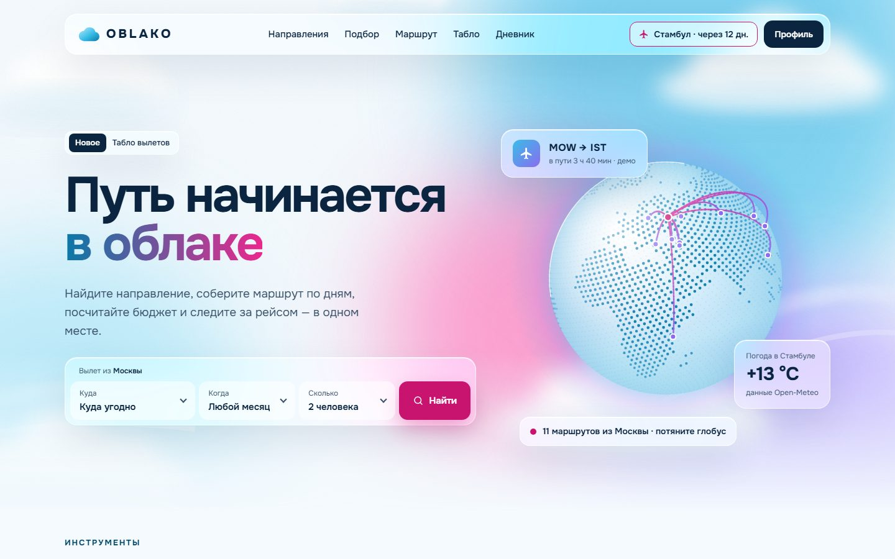
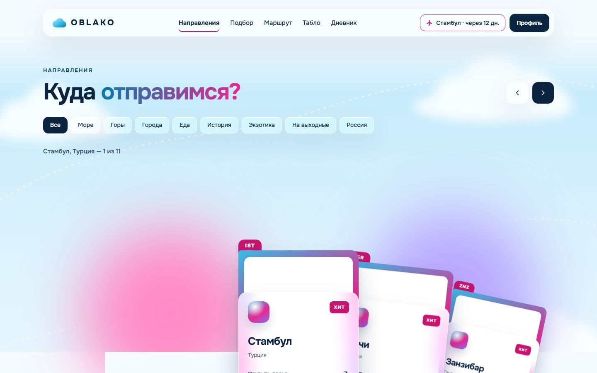
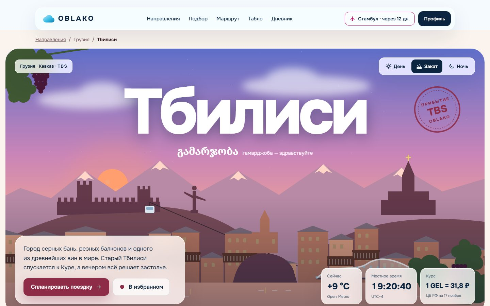
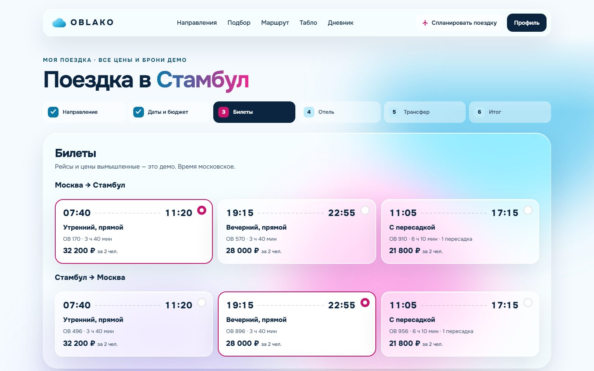
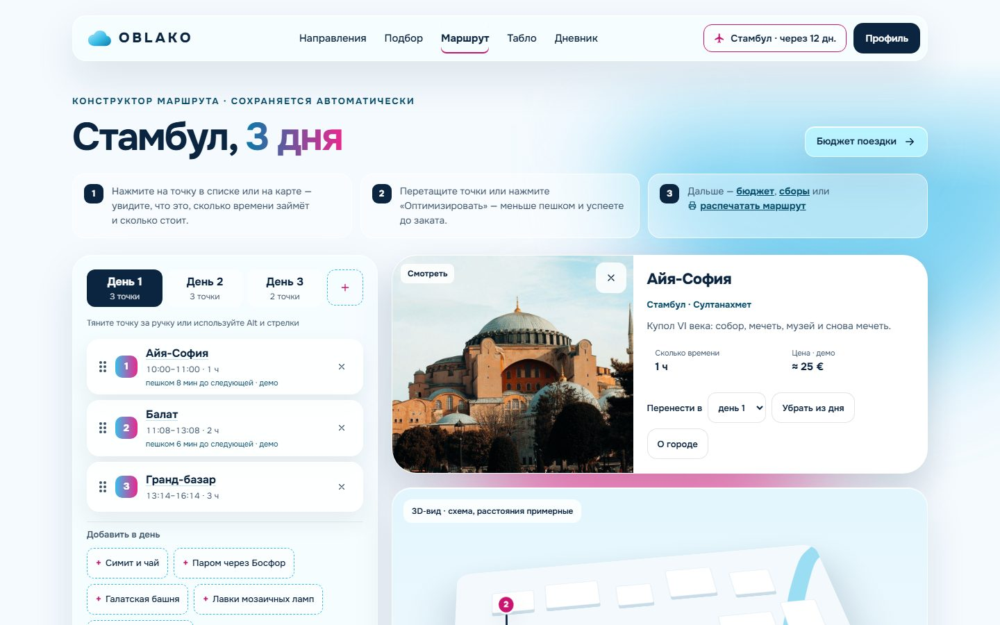
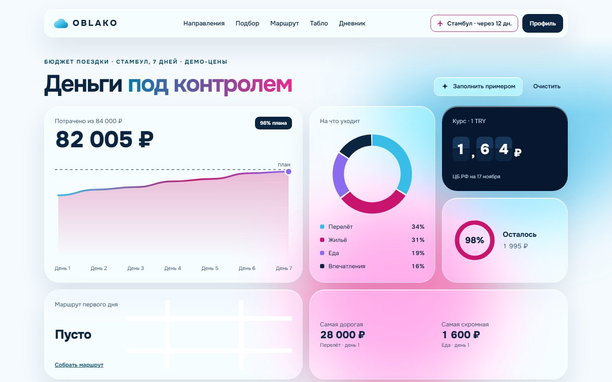
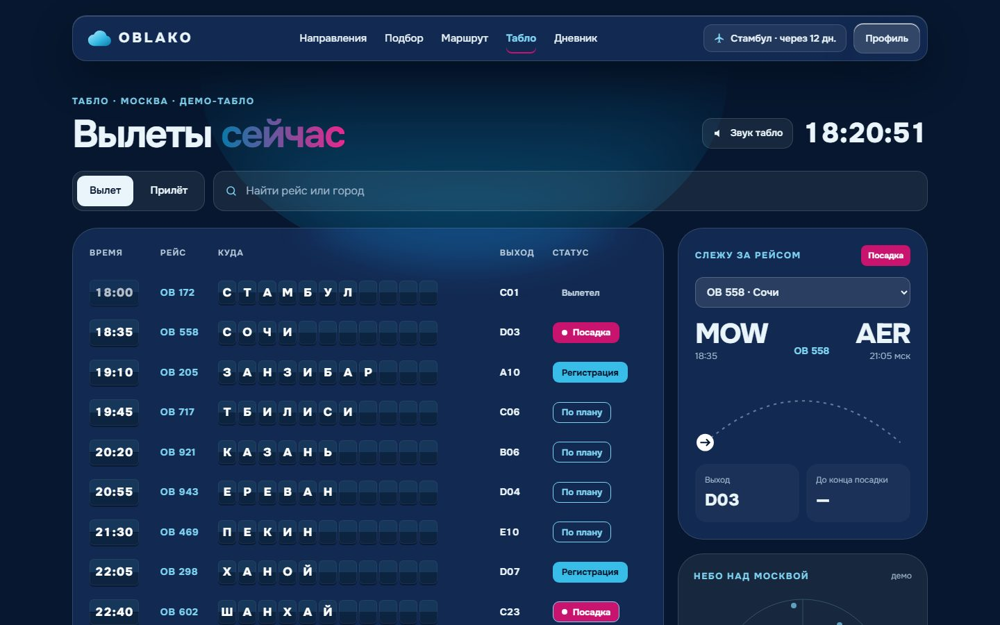
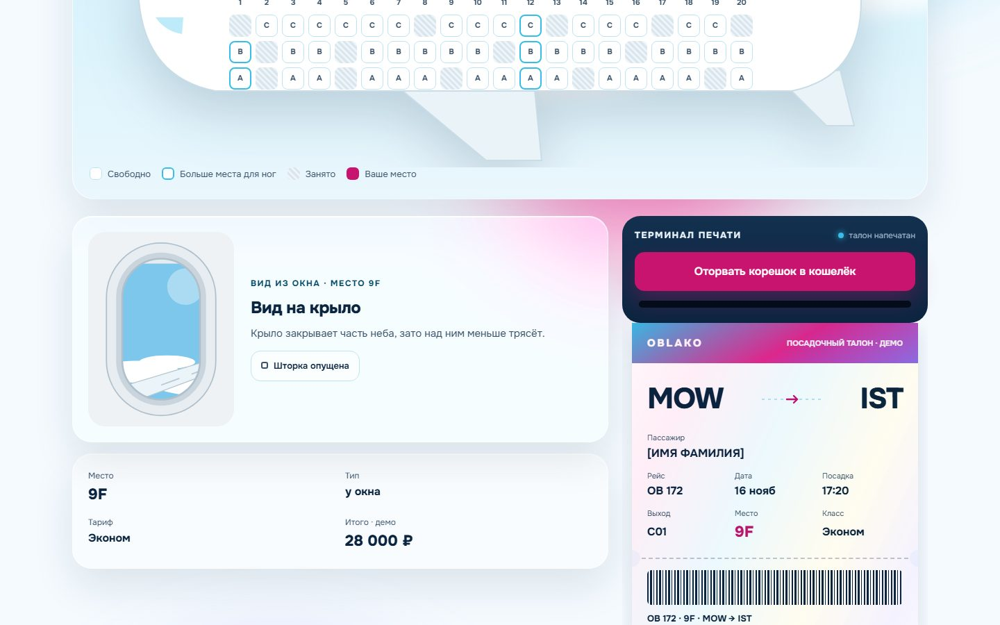
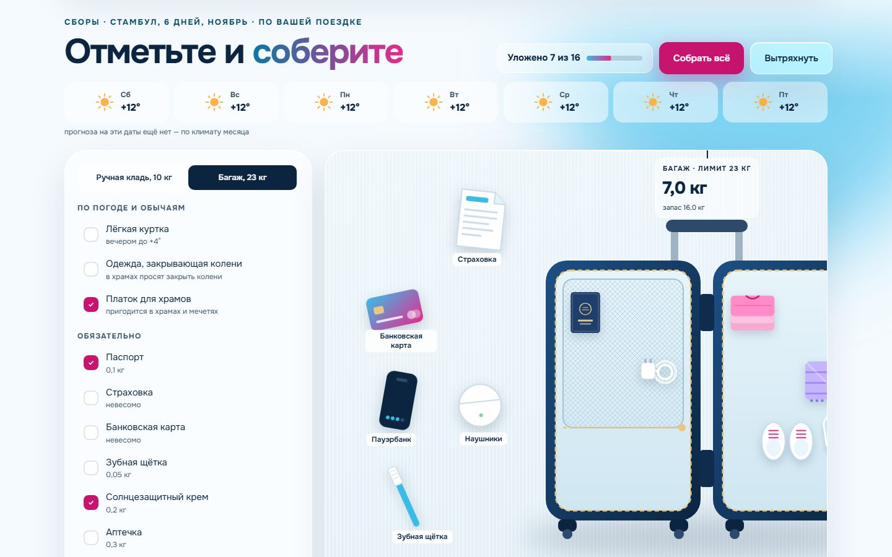
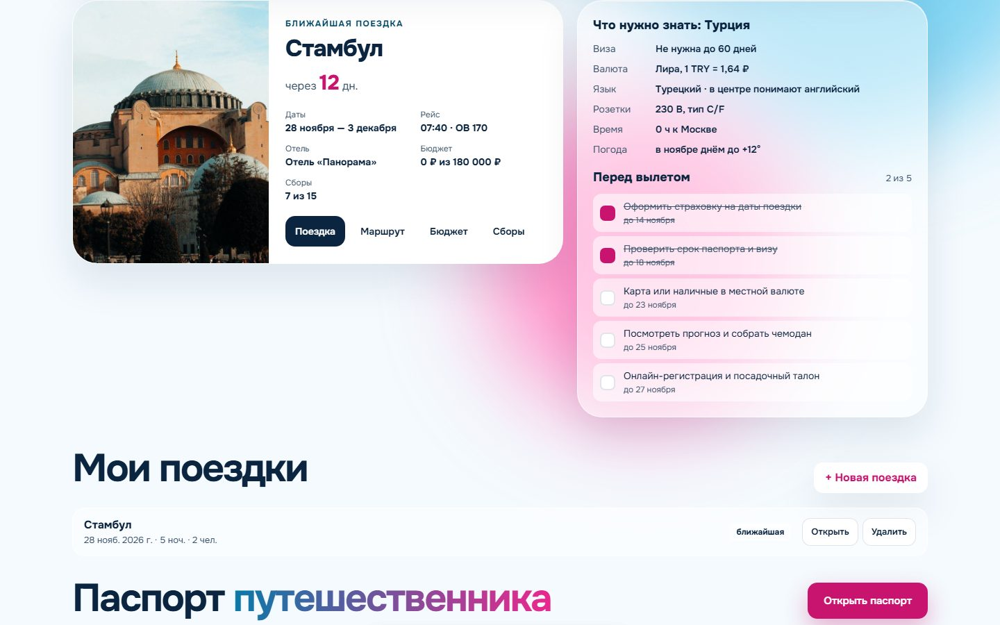

<div align="center">

# OBLAKO

**Путешествия без хлопот — от «куда бы поехать?» до штампа в паспорте**

Некоммерческий портфолио-проект: сайт для планирования поездки целиком.
Подбор направления, билеты и отель, маршрут по дням, бюджет, сборы, табло вылетов, дневник и профиль — всё в браузере, без бэкенда.




</div>

## Как выглядит

<table>
  <tr>
    <td width="50%">
      
      <p align="center"><b>Направления</b><br/><sub>Папки-досье, подборки и каталог с сортировкой</sub></p>
    </td>
    <td width="50%">
      
      <p align="center"><b>Город</b><br/><sub>Иллюстрированная сцена со сменой времени суток</sub></p>
    </td>
  </tr>
  <tr>
    <td width="50%">
      
      <p align="center"><b>Моя поездка</b><br/><sub>Билеты, отель, трансфер и итог в одном мастере</sub></p>
    </td>
    <td width="50%">
      
      <p align="center"><b>Маршрут</b><br/><sub>Дни, перетаскивание точек, карточки мест и 3D-карта</sub></p>
    </td>
  </tr>
  <tr>
    <td width="50%">
      
      <p align="center"><b>Бюджет</b><br/><sub>Траты по дням, категории и курс ЦБ</sub></p>
    </td>
    <td width="50%">
      
      <p align="center"><b>Табло</b><br/><sub>Перекидные буквы, радар и слежение за рейсом</sub></p>
    </td>
  </tr>
  <tr>
    <td width="50%">
      
      <p align="center"><b>Бронирование</b><br/><sub>Схема салона, вид из окна и голографический талон</sub></p>
    </td>
    <td width="50%">
      
      <p align="center"><b>Сборы</b><br/><sub>Список по погоде и обычаям, свои вещи и вес багажа</sub></p>
    </td>
  </tr>
  <tr>
    <td colspan="2">
      
      <p align="center"><b>Профиль</b><br/><sub>Ближайшая поездка с отсчётом, справка о стране, чек-лист и паспорт со штампами</sub></p>
    </td>
  </tr>
</table>

## Что умеет

- **Подбор поездки** — пять шагов: настроение, даты, бюджет, расчёт и результат с маршрутом.
- **Моя поездка** — сквозной сценарий: даты и бюджет → билеты → отель → трансфер → итог. Сохранённая поездка сама настраивает бюджет, маршрут и сборы, появляется в шапке и профиле, выгружается в календарь (`.ics`) и на печать.
- **Маршрут** — дни, перетаскивание и клавиатура, «оптимизировать порядок», карточки мест, циферблат дня и печатная версия.
- **Бюджет** — траты в рублях и местной валюте по курсу ЦБ, график по дням и кольцо категорий.
- **Сборы** — советы по прогнозу и обычаям города, свои вещи с весом, лимит ручной клади или багажа.
- **Табло, бронирование, дневник и профиль** — с вниманием к деталям и анимациям.

## Стек

React 18 · Vite · TypeScript (strict) · React Router · CSS Modules · GSAP (ScrollTrigger, Draggable, Flip, Inertia) · Lenis · Zustand · idb-keyval · Vitest + Testing Library

- Доступность WCAG AA: семантика, клавиатура, `aria`, контраст проверен axe.
- `prefers-reduced-motion` уважается везде.
- Поддержка Safari 14+ и последних Chrome, Firefox, Edge.

## Запуск

```bash
npm install
npm run dev        # локально
npm test           # тесты
npm run build      # сборка
```

## Данные

- Погода — [Open-Meteo](https://open-meteo.com/), курсы — ЦБ РФ через cbr-xml-daily.ru (с демо-фолбэком).
- Цены, рейсы, отели и истории — демонстрационные, это подписано в интерфейсе.
- Фото — [Pexels](https://www.pexels.com/license/), ссылки на все снимки — на странице «О проекте» и в `src/data/photo-credits.json`.

## Структура

| Путь                | Что                                             |
| ------------------- | ----------------------------------------------- |
| `docs/design/`      | макеты `.dc.html` — эталон вида и поведения     |
| `docs/spec/`        | токены, анимации, данные, доступность, страницы |
| `docs/screenshots/` | скриншоты для этого README                      |
| `src/data/`         | города в JSON, индекс, кредиты фото             |
| `src/pages/`        | страницы сайта                                  |
| `src/components/`   | компоненты по разделам                          |
| `public/photos/`    | фото направлений                                |

## Автор

Дизайн и разработка — **[mvenmass](https://github.com/MvenMass)**.

Проект некоммерческий. Фото распространяются по лицензии Pexels.
